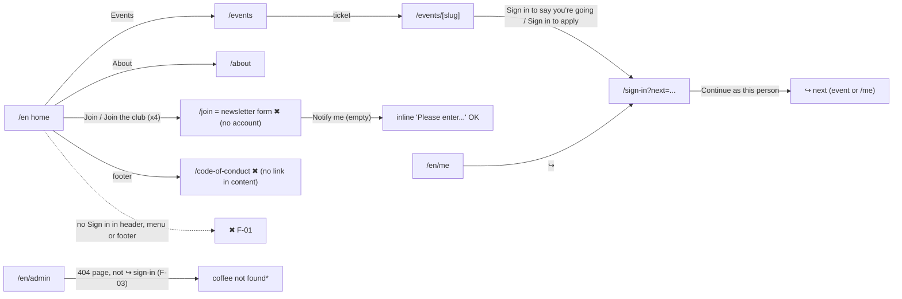
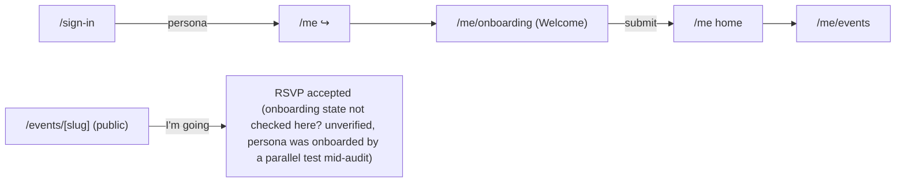
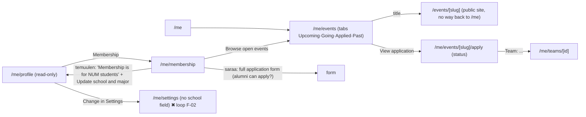
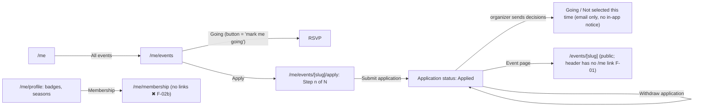
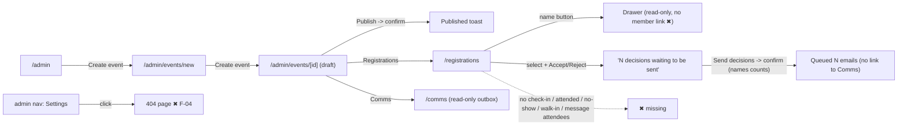
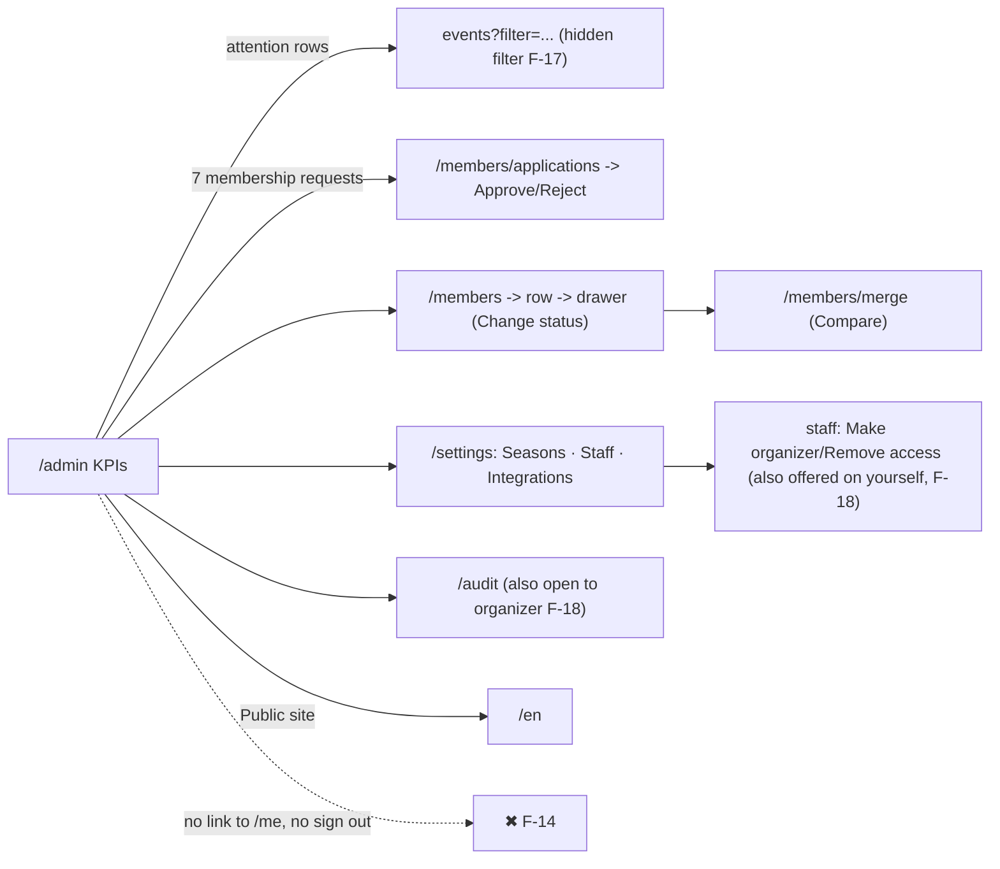

# Hackum user-flow and navigation audit (2026-11-16)

Scope: what is implemented **today** on `feat/hackum-os` (commit `edf537a` plus the working tree of parallel agents), dev server `:3100`, mock DB. Method: scripted headless crawl of every persona (depth 3, 1280 px, `/en`; 56-90 pages each), 390 px overflow and tap-target sweep of 60 routes in `/en` and `/mn`, plus scripted click-through of the flows below (Playwright MCP for visual spot checks). Nothing under `src/` was changed. Data created is prefixed `AUDIT-` (events `e_759` published meetup, `e_771` published application event with 2 applications and 2 decisions sent, `e_774` draft; RSVPs by new-guest, temuulen, anuujin on `audit-test-workshop`).

Legend: P0 = broken / dead end / security-looking, P1 = confusing or inconsistent, P2 = polish. "Plan" column: `Task N` = already covered by `2026-11-16-hackum-v2-roles-forms.md`, `NEW` = not in the plan. `*` after a status = the page renders "not found" or redirects client-side but the HTTP status is 200 (F-05).

## 1. Flow maps (screens = nodes, `-->|label|` = the button/link, `✖` dead end, `↪` redirect)

### 1.1 Signed-out visitor (discover, read, create account)

Journey: discover, read an event, create account, onboarding, RSVP, confirmation. **Breaks at "create account": there is no account creation anywhere (the `/join` page asks for name + email for a newsletter and says "recruitment is announced on Instagram"), and nothing in the chrome says "Sign in".** The only door is the RSVP button on an event page.

### 1.2 New guest (account exists, onboarding not done)

`new-guest` was consumed by parallel e2e runs during the audit ("Hi, Test"), so only the crawl-time redirect (`/en/me` ↪ `/en/me/onboarding?next=%2Fen%2Fme`, h1 "Welcome") is verified.

### 1.3 Guest from another school (temuulen) and alumni (saraa)

Temuulen is told why (new card on `/me/membership`), but the fix link leads in a circle. Alumni has no alumni-specific surface (no mentor/alumni events/stay-connected page) and sees the student membership form.

### 1.4 NUM member (anuujin): find event, apply with team, decision, badges, profile

### 1.5 Organizer on event day (dev-organizer)

### 1.6 Club leader (dev-admin)

## 2. Route inventory (as of crawl; `SO` signed-out, `NG` new-guest, `GU` temuulen, `ME` anuujin, `AL` saraa, `OR` organizer, `AD` admin)

| Route | Shows | SO | NG | GU/ME/AL | OR | AD |
|---|---|---|---|---|---|---|
| `/{lang}`, `/events`, `/about`, `/code-of-conduct`, `/join`, `/sign-in` | public site; `/join` = newsletter; `/sign-in` = persona picker (dev) | 200 | 200 | 200 | 200 | 200 |
| `/events/[slug]` | public event + RSVP panel (state per persona) | 200 | 200 | 200 | 200 | 200 |
| `/events/<unknown/draft>` | 404 | 404 | 404 | 404 | 404 | 404 |
| `/me` | member home | ↪ `/sign-in?next=` * | ↪ `/me/onboarding?next=` * | 200 | 200 | 200 |
| `/me/onboarding` | welcome form | ↪ sign-in * | 200 | redirects/404 (unverified) | same | same |
| `/me/events`, `/me/profile`, `/me/settings`, `/me/membership`, `/me/events/[slug]/apply`, `/me/teams/[id]` | member app | ↪ sign-in * | ↪ onboarding * | 200 (`/membership` differs: NUM-only card / form / history) | 200 | 200 |
| `/me/events/<unknown>/apply`, `/me/teams/<unknown>` | "Page not found" inside shell | ↪ sign-in * | ↪ onboarding * | 404* | 404* | 404* |
| `/admin` and every `/admin/**` | backoffice | **404 page*** (F-03) | 404* | 404* | 200 | 200 |
| `/admin/settings`, `/settings/staff`, `/settings/integrations` | admin only | 404* | 404* | 404* | **404*** (but linked in nav, F-04) | 200 |
| `/admin/audit` | audit log | 404* | 404* | 404* | **200** (F-18) | 200 |
| `/admin/members/merge` | merge | 404* | 404* | 404* | 200, "admin only" lock card | 200 |
| `/admin/kit` | UI kit (not in nav) | 404* | 404* | 404* | 200 | 200 |
| `/admin/events/[id]/{registrations,analytics,comms}` | event tabs | 404* | 404* | 404* | 200 | 200 |
| `/admin/events/[id]/registrations/export` | CSV | 404 (true) | 404 | 404 (member) | 200 | 200 |
| `/api/events/[slug]/ics`, `/api/calendar/[token]` | calendar | 200 | 200 | 200 | 200 | 200 (unknown slug 404) |
| `/me/notifications`, `/admin/forms`, `/admin/analytics`, `/admin/inbox` | planned (Tasks 6, 9, 11) | not built | | | | 404* today |
| `/mn/**` | same routes; no overflow at 390 px on 60 routes tried | = `/en` | | | | |

## 3. Findings

| ID | Pri | Persona | Steps | Observed | Expected | Suggested fix | Where | Plan |
|---|---|---|---|---|---|---|---|---|
| F-01 | P0 | signed-out, every persona | open `/en` (and the 390 px Menu) | Header, mobile menu, footer: Events, About, language, Instagram, **Join** (to a newsletter form). No "Sign in", no "My Hackum"/"Dashboard"/avatar for signed-in people; identical for all 7 personas. After an event page ("Event page" link in /me) there is no way back to `/me` | Sign in visible when signed out; account/dashboard entry when signed in | Header gets session-aware slot (Sign in, or avatar menu with My Hackum / Dashboard / Sign out) | `src/components/Header.tsx:79,89`, `src/components/Footer.tsx:15` | **NEW** (Task 5 builds the forms, Task 7 the shells; neither touches the public header) |
| F-02 | P0 | temuulen (MUST guest) | `/me/membership` → "Update school and major" → `/me/profile` → "Change in Settings" → `/me/settings` | Loop. Profile is read-only; settings has notifications, language, privacy, calendar, theme only | School/major editable where the link sends you | `ProfileForm` + `SchoolMajorFields` on `/me/profile`; link text to match | `src/app/[lang]/me/membership/page.tsx:81`, profile page | Task 8 |
| F-03 | P0 | signed-out staff bookmark | open `/en/admin/events` signed out | "coffee not found" (HTTP 200) | `↪ /en/sign-in?next=%2Fen%2Fadmin%2Fevents` (spec §3); non-staff keep 404 | `requireStaffPage`: no session → `redirect(sign-in?next)`, session without role → `notFound()` | `src/lib/server/session.ts:44-48`, `src/app/[lang]/admin/layout.tsx:25` | spec §3 + Task 13 assert it, **no task implements it** |
| F-04 | P0 | dev-organizer | open `/en/admin`, click **Settings** | Nav item present, page is the 404 page. Audit also shown and readable (F-18). `adminNav` is not role-aware | Organizer nav hides admin-only items | `adminNav(lang, role)`, `adminOnly` flag | `src/lib/admin/nav.ts:12-20`, `src/components/admin/AdminShell.tsx:29` | Task 7 |
| F-05 | P1 | all | `curl -i /en/admin` as member; `/en/me` signed out | 200 for "not found" and for client redirects (streamed under Suspense). Only unknown event slugs give a real 404 (proxy rewrite). Monitors, crawlers and tests cannot see broken states | 404 / 307 status | Do the auth check in `proxy.ts` (cookie → 307/404 before streaming) or per-segment `await connection()` outside Suspense for the guard | `src/proxy.ts`, `src/lib/server/session.ts` | **NEW** |
| F-06 | P1 | anyone | pick "Guest (Bayar, NUM)" on `/sign-in` (profile missing in the running store) | Silent bounce back to `/sign-in?next=...`, no message | Error: "That demo account does not exist, reset demo data" | `signInAs`: unknown handle → redirect with `?error=unknown` and show it | `src/lib/server/auth-actions.ts:18-19` | **NEW** (small) |
| F-07 | P1 | all (dev) | open `/en`, `/en/about`, `/en/events`, `/en/me/...`, `/en/admin/settings`; browser console | `console.error` "Route "/[lang]/about": Next.js encountered URL data during prerendering ... `params` accessed outside `<Suspense>`" and "Could not validate `instant`". Next dev badge "1 Issue". Only `events/[slug]/page.tsx:31` sets `instant = false` | Clean console | `generateStaticParams` on `[lang]` pages or `export const instant = false` per page; read `node_modules/next/dist/docs/01-app/03-api-reference/03-file-conventions/02-route-segment-config/instant.md` | `src/app/[lang]/(site)/{page,about/page,events/page}.tsx`, `me/**`, `admin/settings/**` | **NEW** |
| F-08 | P1 | all with theme set | open any admin page after choosing a theme | `Hydration failed` / `A tree hydrated but some attributes ... didn't match` on `ThemeToggle` label `className` (stored theme read before mount). Seen on `/mn/admin/events`, `/mn/admin/members`, `/en/admin/events/[id]` | none | render selected state after mount (or `suppressHydrationWarning` + CSS from `[data-theme]`) | `src/components/ui/ThemeToggle.tsx:13-20` | **NEW** |
| F-09 | P2 | admin | `/en/admin/comms?status=failed`, press the language link | goes to `/mn/admin/comms` (query dropped); same for `/me/events?tab=going` | keeps query | `switchLocale(pathname + search)` | `src/i18n/config.ts:15-20`, shells | **NEW** |
| F-10 | P2 | everyone | open `/en/code-of-conduct` | Text only; nothing to click in content, no "report a problem" contact, no back link | contact + "Back" | add contact row | `src/app/[lang]/(site)/code-of-conduct/page.tsx` | **NEW** |
| F-11 | P1 | signed-out, members-only events | click **Join** / **Become a member** | Lands on a newsletter form titled "Join Hackum" (recruitment "announced on Instagram"); four CTAs say "Join the club" | account + membership application | one real Join flow | `src/app/[lang]/(site)/join/page.tsx`, `src/components/SubscribeForm.tsx` | Task 5 |
| F-12 | P1 | temuulen, saraa, new-guest on members-only event | `/events/members-meetup-live` | "This event is for Hackum members only. **Become a member**" → `/join` (newsletter). For a MUST guest membership is impossible (F-02 card says so) | Explain "NUM students only" and link to `/me/membership` (or to Browse open events) | per-reason CTA | `src/components/public/RsvpPanel.tsx:197` | Task 10 touches the panel, not this CTA: **NEW** |
| F-13 | P1 | member | `/me/events` Upcoming card | Button reads **Going** but means "mark me going"; the same word is the status on other cards and the Tag on photos. Public page says "I'm going"; admin says "Accepted" for the same application state (member sees "Going / Cancel RSVP", F-20) | verbs for actions, StatusPill for state (plan terminology) | rename `me.rsvp` to "I'm going" (mn "Ирнэ"), keep "Going" as state | `src/i18n/areas/me.ts:242` | **NEW** (extends Task 4 terminology) |
| F-14 | P1 | staff | open `/me` or `/admin` | `/me` menu: Profile, Settings, language, Sign out (demo): no Dashboard. Admin: "Public site", no My Hackum, no sign out (only the "View as" select) | context switch + avatar menu | `ContextSwitch`, `AvatarMenu` | `src/components/me/MeShell.tsx:54-56`, `AdminShell.tsx:86` | Task 7 |
| F-15 | P1 | organizer | create event with only title/date/slug, Publish | Allowed (confirm says "appears on the public site"). Public page then reads "X **was a** in-person event organised by Hackum ... in 2026. Photos and results are on our Instagram." for an **upcoming** event; admin preview card (EventPreview) does not show the description, so the gap is invisible. Dashboard flags only "missing English text" | publish checklist (description, venue, cover, EN) and a future-tense fallback | `en.ts:115` fallback only for past events; checklist in Publish confirm | `src/i18n/en.ts:115`, `src/components/admin/events/StatusActions.tsx`, `EventPreview.tsx` | **NEW** |
| F-16 | P1 | organizer | `/admin/events/[id]/registrations`: click a row; open a name; use a status chip | Row click does nothing (name button only); drawer is read-only (no link to the member or to their other registrations, no cancel/promote); status chip filter not in URL, no "Clear filters" when only a chip is set; "No registrations match" without action | rows open the drawer, drawer links to member + actions, filters in URL | Task 12 + member deep link | `src/components/admin/events/RegistrationsView.tsx:65`, `RegistrationDrawer.tsx` | Task 12 (member link NEW) |
| F-17 | P1 | admin | dashboard "Needs attention" rows | Links apply a hidden preset (`?filter=`) on the events list: chips show "All 1", no sign a filter is active. "64 hackathon applications to review" lands on a list of events, not the DevHack registrations. "1 event missing English" vs 8 "Needs English" badges in the list | row goes to the object; active filter shown with Clear | link applications row to the event's registrations (or only the event when 1); render preset as removable chip | `src/app/[lang]/admin/events/page.tsx:26`, `Dashboard.tsx` | Task 12 (filters), link target NEW |
| F-18 | P1 | organizer; admin | `/en/admin/audit` as organizer; `/admin/settings/staff` | Audit open to organizer (spec: admin only). Staff list offers **Make organizer / Remove access on yourself and the last admin**; server blocks with `conflict` (not confirmed in UI to avoid risk) | hide or disable with reason | disable own row + "last admin" tooltip | `src/app/[lang]/admin/audit/page.tsx:20`, `src/components/admin/settings/StaffManager.tsx:39` | audit: Task 7; staff buttons NEW |
| F-19 | P2 | all | tab titles | every admin page is "Admin \| Hackum Students Club"; `/me` home uses the site template ("Home \| Hackum Students Club") while others use "\| My Hackum" | page-specific titles | `generateMetadata` per admin page | `src/app/[lang]/admin/layout.tsx:20`, `me/layout.tsx` | **NEW** |
| F-20 | P1 | member after decision | `/me/events/[slug]/apply` after "Send decisions" | Accepted = "Going / Application accepted", button **Cancel RSVP**; admin shows "Accepted". No confirm-attendance step; no in-app notice (email only; `Queued 2 emails`) | "Accepted: confirm you'll come / decline"; one word per state | Task 6 for notices; copy + confirm step NEW | `ApplicationStatus.tsx`, `i18n/areas/me.ts` | partly Task 6 |
| F-21 | P2 | member at 390 px | `/me`, `/me/events`, `/me/profile` | Tap targets < 44 px: event title links 22 px, "Google Calendar" 24, "Change in Settings" 19, "All events" 40 (rubric: ≥ 44). No horizontal scroll anywhere (60 routes, en+mn) | ≥ 44 | `min-h-11` + padding on those links | `src/components/me/EventCard.tsx:94`, `HomeParts.tsx`, `parts.tsx` | Task 7 (laptop/shell) partly; **NEW** |
| F-22 | P2 | member | RSVP, "Google Calendar" | link `details=http://localhost:3000/en/events/...` (wrong port/host in dev; empty `location=` for events without venue) | public URL, no empty param | `SITE_URL` env in deploy; omit empty location | `src/lib/site-url.ts:5` | **NEW** |
| F-23 | P2 | member | apply to event with no questions/teams | "Step 1 of 1 / Review (current step)" | skip step header for single-step | hide `stepOf` when 1 step | `src/components/me/ApplyFlow.tsx:265` | **NEW** |
| F-24 | P2 | organizer | Send decisions | Toast "Queued 2 emails": no link to the event's Comms; Comms is read-only | toast with "View in Comms" | action link in toast | `StatusActions.tsx`, `RegistrationsView.tsx` | **NEW** |
| F-25 | P2 | admin | `/admin/audit` | "Dev Admin changed the status of “X”" without from→to | "Draft → Published" | include diff in line | audit view | **NEW** |
| F-26 | P2 | member | `/me/membership`, `/me/profile` | member sees "applications are open until December 21" banner; page has no link; Membership is not in `/me` nav (only via profile card whose accessible name is "MembershipApply, history, seasons") | status card + next action ("Renew for 2027" when open) | separator + CTA | `membership/page.tsx`, `parts.tsx` | Task 8 partly |
| F-27 | P2 | saraa (alumni) | `/me/membership` | Alumna gets the student application form with "Teams you're interested in" | alumni path (mentor, alumni events) | branch on status | `membership/page.tsx` | **NEW** |
| F-28 | P2 | admin | `/admin/comms` | status tabs are links (URL) but template chips are buttons (lost on refresh); "Send queued now" unexplained | same control, helper text | Task 12 + copy | `CommsView`/`OutboxTable` | Task 12 |
| F-29 | P1 | any visitor / organizer | admin top bar "View as" select, `/me/settings` persona select, `/sign-in` | `signInAs` has no authz: anyone (including an organizer) becomes admin by design of the mock; gated only by `mockEnabled()` (`NODE_ENV !== "production" \|\| ADMIN_PREVIEW=1`) | dev-only, never in prod | move to dev disclosure (Task 5/7), keep `first-request-404` e2e, add a test that `ADMIN_PREVIEW=1` is not set in the production env file | `src/lib/server/auth-actions.ts:14-20`, `src/lib/mockdb/store.ts:41` | Tasks 5, 7, 13 |
| F-30 | P2 | organizer | new event, seats = "abc" | field gets `aria-invalid` but no visible message was found in `[role=alert]` (unverified: message may live in an `id` sibling) | visible message | verify in `EventForm` | `src/components/admin/events/EventForm.tsx` | **NEW** (verify) |
| F-31 | P2 | organizer | event page | two different "Cancel": sticky bar "Cancel" (discard edits) and header "Cancel event" (destructive) | distinct labels ("Discard changes") | rename | `EventForm.tsx`, `StatusActions.tsx` | **NEW** |

Positives worth keeping (do not regress): confirm dialogs name object and count (Publish, Send decisions, Cancel RSVP); "Nobody is emailed until you send" helper; unknown slug true 404; export CSV staff-only; merge guarded in the rule with a lock card; email preview iframe is `sandbox=""`; drawers close on Esc and return focus; no horizontal scroll at 390 px in en/mn.

## 4. Missing features and flows, by user impact

1. **Create account / sign in / join** in public chrome and as real forms (F-01, F-11). Blocks every new student. (Tasks 5; header NEW)
2. **Edit profile** (name, photo, school, major) (F-02). Blocks MUST/other-school guests who study at NUM and every member. (Task 8)
3. **Event-day tooling**: check-in, mark attended / no-show, walk-in add, QR; today `attended`/`no_show` only come from seed data. Not in the plan: NEW.
4. **Message registrants** (compose announcement to going / waitlisted / applicants, with preview and count). Comms is a read-only outbox; the `announcement` template has no composer. NEW.
5. **In-app notifications** (bell, decision notices) (Task 6).
6. **Per-registration staff actions**: promote from waitlist, cancel, move, resend confirmation, undo a decision. NEW.
7. **Publish readiness checklist** and event duplicate/clone (F-15). NEW.
8. **Accepted-applicant confirmation** (accept/decline seat) and waitlist auto-promotion notice (F-20). NEW.
9. **Staff to member deep links**: registration → member → profile; audit row → object; notification → object (F-16, F-25). Partly Task 12.
10. **Alumni home**: mentor sign-up, alumni events, stay-in-touch (F-27). NEW.
11. **Global admin search** (people, events). NEW.
12. **Forms hub, analytics, inbox** (Tasks 9, 11, 6). Routes still 404 today.
13. Account deletion / data export for members (privacy). NEW.

## 5. Fix plan (append to `2026-11-16-hackum-v2-roles-forms.md`; numbering continues after Task 13; order = P0 first)

### Task 14: Public chrome knows who you are (F-01, F-12, F-10)
**Files:** Modify `src/components/Header.tsx`, `src/components/Footer.tsx`, `src/components/public/RsvpPanel.tsx`, `src/app/[lang]/(site)/layout.tsx` (session read behind Suspense), `src/i18n/areas/public.ts`, `src/app/[lang]/(site)/code-of-conduct/page.tsx`; Test `tests/e2e/public-chrome.spec.ts`, un-fixme `F-01` in `tests/e2e/nav-crawl.spec.ts`.
- [ ] **Step 1: Failing tests.** `public-chrome.spec`: signed out → `header` has link "Sign in" to `/en/sign-in` (also inside the 390 px Menu); `anuujin` → header has avatar menu with "My Hackum"; `dev-organizer` → also "Dashboard"; members-only event as `temuulen` → CTA text "NUM students only" and href `/en/me/membership`, not `/en/join`; code-of-conduct has a mailto/Instagram contact link.
- [ ] **Step 2:** run, expect FAIL. **Step 3:** implement (server-read session in a small `<Suspense>` slot so the page stays static). **Step 4:** run + `nav-crawl` + `a11y`; commit `feat(public): sign-in and account entry in the site header`.

### Task 15: Staff sign-in redirect, honest HTTP status, role-aware nav (F-03, F-04, F-05, F-18)
**Files:** Modify `src/proxy.ts`, `src/lib/server/session.ts`, `src/lib/admin/nav.ts`, `AdminShell.tsx`, `src/app/[lang]/admin/audit/page.tsx`, `StaffManager.tsx`; Test `tests/unit/admin-nav.test.ts`, `tests/e2e/route-matrix.spec.ts` (Task 13 file), un-fixme F-03/F-04/F-05 in `nav-crawl.spec.ts` and remove their `KNOWN` entries.
- [ ] **Step 1: Failing tests.** `adminNav("en","organizer")` has no `settings`/`audit` keys, `adminNav("en","admin")` has both; e2e: signed-out `GET /en/admin/events` → 307 `/en/sign-in?next=%2Fen%2Fadmin%2Fevents`; member `GET /en/admin` → status 404; signed-out `/en/me` → 307; organizer `/en/admin/audit` → 404; staff list disables "Remove access" on the row of the current admin with a visible reason.
- [ ] **Steps 2-4:** run FAIL; implement the guard in `proxy.ts` for `/me` and `/admin` (cookie only, then rules still re-check); PASS; commit `fix(auth): redirect signed-out visitors, 404 status for non-staff, organizer nav without admin-only items`.

### Task 16: Profile edit closes the school loop (F-02, F-26) — fold into Task 8
Add to Task 8's e2e: `temuulen` follows "Update school and major" and the landing page has an editable school select (the `F-02` fixme in `nav-crawl.spec.ts` is that assertion; un-fixme it when Task 8 ships). Add a primary next action on `/me/membership` for members ("Renew for 2027" while the season is open) so `F-02b` passes.

### Task 17: Console hygiene: instant shell + hydration (F-07, F-08)
**Files:** Modify `[lang]` pages listed in F-07, `src/components/ui/ThemeToggle.tsx`.
- [ ] **Step 1:** un-fixme `F-07`/`F-08` for all personas (they are the failing tests); also `tests/unit/theme-toggle.test.tsx`: server markup (no storage) equals first client render when `localStorage["ops-theme"]="dark"`.
- [ ] **Steps 2-4:** fix per Next doc `instant.md` (Suspense around `await params` readers or `instant = false`), ThemeToggle mounts selected state in an effect; run `npx playwright test tests/e2e/nav-crawl.spec.ts`; commit `fix: clean dev console (instant shell validation, theme toggle hydration)`.

### Task 18: Publish readiness and copy that matches the object (F-15, F-13, F-20, F-23, F-31)
**Files:** `src/i18n/en.ts:115` (+mn), `src/i18n/areas/me.ts`, `StatusActions.tsx`, `ApplyFlow.tsx`, `ApplicationStatus.tsx`, `EventForm.tsx`.
- [ ] **Step 1: Failing tests.** unit: fallback overview for an event with `starts_at` in the future contains neither "was a" nor "organised"; e2e: publishing an event without description shows a confirm list "No description, no venue, no cover" with a "Publish anyway" button; `/me/events` upcoming card button text is "I'm going"; accepted applicant sees "Accepted" and "Confirm" / "Can't come"; single-step apply has no "Step 1 of 1"; sticky bar says "Discard changes".
- [ ] **Steps 2-4:** implement, run unit + e2e; commit `feat(events): publish checklist, action vs state wording`.

### Task 19: Staff drill-through and visible filters (F-16, F-17, F-24, F-25, F-28) — fold into Task 12
Add to `lists-consistency.spec.ts`: registration drawer contains a link to `/en/admin/members?q=<handle>` (or member drawer deep link); dashboard "applications to review" row href is `/en/admin/events/<id>/registrations?status=applied`; a preset filter renders a removable chip and "Clear filters"; "Send decisions" toast has a "View in Comms" action; audit status line contains "Draft → Published".

### Task 20: Small correctness items (F-06, F-09, F-19, F-21, F-22, F-30)
Tests: unit `switchLocale("/en/admin/comms?status=failed","mn")` keeps the query (un-fixme F-09 e2e); signing in with an unknown handle shows `role=alert`; `document.title` differs on `/admin/events` vs `/admin/members`; every interactive element in `/me` home and events at 390 px is ≥ 44 px (extend `member-app.spec`); ICS/Google link uses `SITE_URL` and has no empty `location=`; EventForm shows a text message for non-numeric seats.

### Task 21: Event-day tooling and communications (missing features 3, 4, 6)
Own spec + plan (new slice): attendance marking and walk-ins, "Message attendees" composer with preview and recipient count, per-registration actions with undo. Write the spec first: it changes the rule layer (`registrations.ts`, `outbox.ts`).

Order: 14 and 15 first (P0, independent), 17 next (cheap, removes noise from every other agent's runs), then 16/8, 18, 19 (with Task 12), 20, 21.

## 6. Navigation guard

`tests/e2e/nav-crawl.spec.ts` (new, permanent): 7 personas, depth ≤ 3, ≤ 18 pages each (about 30 s warm). Failing-today assertions are `test.fixme` with the finding id (F-01, F-02, F-02b, F-03, F-04, F-05, F-07 and F-08 per persona, F-09, F-10); known failures are filtered from the green tests through `KNOWN` and an `EXPECTED_404` allow-list with reasons.

## 7. Audit limits (read before trusting a negative)
- The dev server was restarted several times by other agents (connection refused windows); retried, not reported.
- `new-guest` was onboarded by a parallel test mid-audit; `bayar` is in `PERSONAS` but missing from the running store (F-06), so neither's onboarding / NUM-guest membership form was submitted. `/me/onboarding` was only seen at crawl time.
- Not confirmed on purpose: staff self-demotion (rule blocks it, but the action was refused by the harness), "Reset demo data", destructive confirms (opened and cancelled only).
- Keyboard checks: Esc closes drawers/dialogs and returns focus; skip link present on every shell; full tab-order walk and screen-reader pass not done.
- Dark mode: dashboard (390/1280) and event page looked intentional; not every page was screenshotted.
